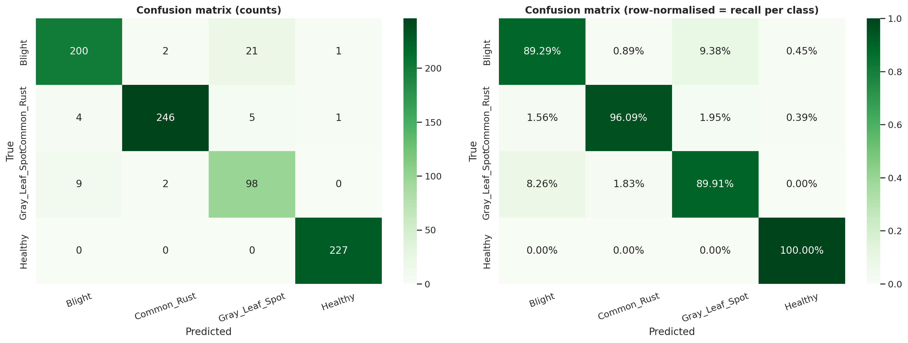
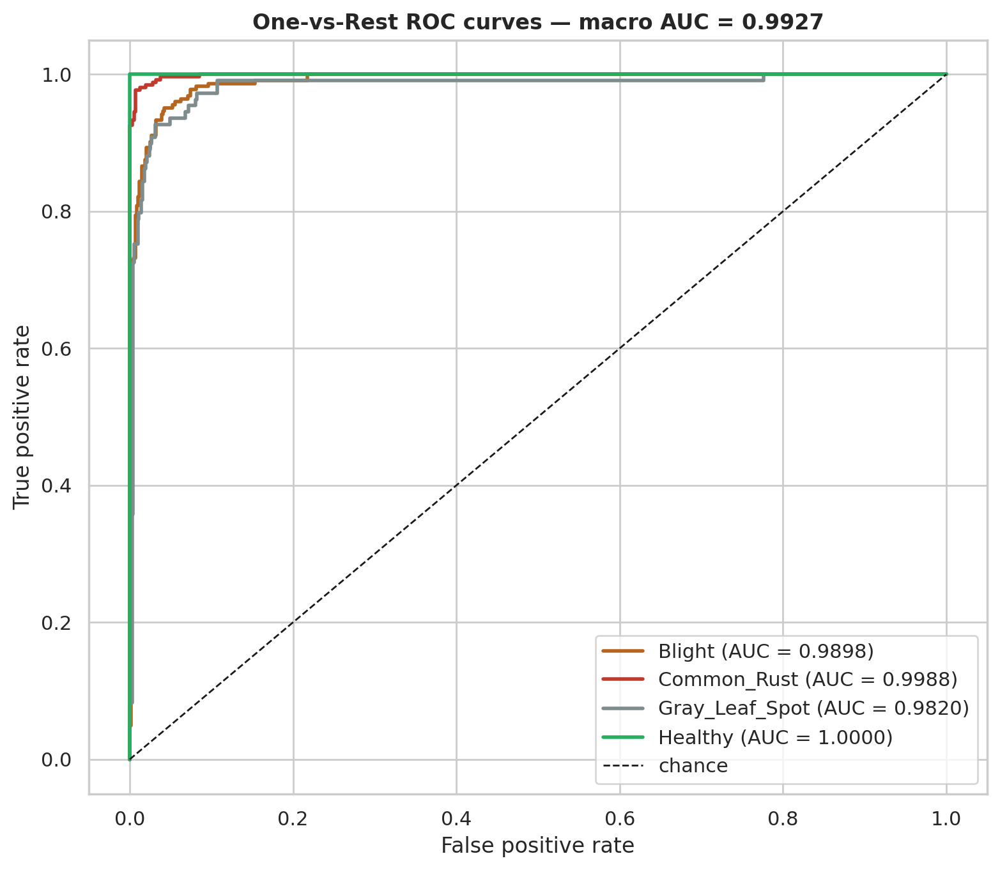
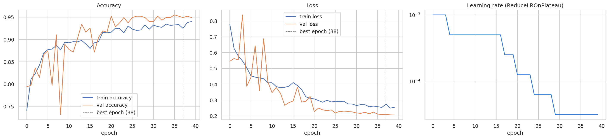
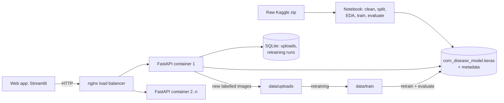
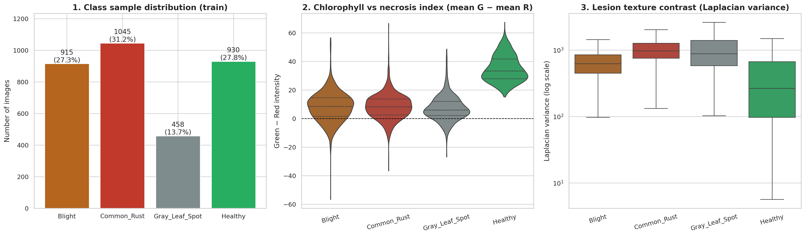
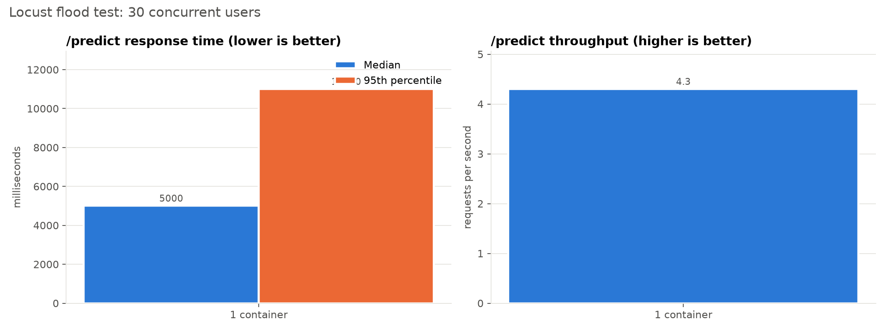

# 🌽 Ibigori: Maize Leaf Disease Detection, an End-to-End MLOps Pipeline

**Ibigori** ("maize" in Kinyarwanda) diagnoses maize leaf diseases from a single photo, and keeps learning from new
labelled photos. A custom convolutional neural network, **trained from scratch**, classifies a leaf as
**Northern Leaf Blight, Common Rust, Gray Leaf Spot or Healthy**. It is served through a FastAPI backend with
bulk upload, a database, automatic retraining and model versioning, a Streamlit dashboard, Docker, an nginx load
balancer, and a deployment on Microsoft Azure.

| | Link |
|---|---|
|  **Video demo** | **[ADD YOUR YOUTUBE LINK HERE]** |
|  **Web app (UI)** | **https://corn-ui.salmonpond-117aecb3.uaenorth.azurecontainerapps.io/field-data** |
|  **API** | **https://corn-api.salmonpond-117aecb3.uaenorth.azurecontainerapps.io/docs** (interactive docs at `/docs`) |
|  **Notebook** | [`notebook/corn_leaf_classification.ipynb`](notebook/corn_leaf_classification.ipynb) |

---

## Contents
1. [Project description](#1-project-description)
2. [Results](#2-results)
3. [How it works](#3-how-it-works)
4. [Dataset and feature insights](#4-dataset-and-feature-insights)
5. [The model: a custom CNN trained from scratch](#5-the-model-a-custom-cnn-trained-from-scratch)
6. [Retraining pipeline and database](#6-retraining-pipeline-and-database)
7. [Web app](#7-web-app)
8. [API](#8-api)
9. [Flood request simulation (Locust)](#9-flood-request-simulation-locust)
10. [Setup: run it yourself](#10-setup-run-it-yourself)
11. [Deployment on Azure](#11-deployment-on-azure)
12. [Repository structure](#12-repository-structure)
13. [Limitations and next steps](#13-limitations-and-next-steps)

---

## 1. Project description

Maize is the staple crop across East Africa. Leaf diseases cut both yield and grain quality, and a smallholder
farmer who spots them early can act in time: remove infected leaves, rotate crops, choose resistant varieties. That
protects the harvest and the price it fetches. This project builds on my Introduction to ML summative (WFP Kenya food
prices, where the mission was helping smallholder farmers get fair prices) and moves from tabular data to
**images**.

**What it does:**
- **Predicts** the disease from one leaf photo and gives the confidence, the probability for every class, and
  advice for the farmer.
- **Refuses pictures that are not maize leaves** (a phone, a cat, a document) instead of guessing a disease.
- **Learns from new data:** users upload labelled photos in bulk. They are saved to a database, preprocessed, and
  used to **retrain the model**, automatically or with one button. A new version is only promoted if it is not worse.
- **Monitors itself:** uptime, model version, latency and traffic, live in the dashboard.
- **Scales:** runs in Docker containers behind an nginx load balancer, tested with Locust.

---

## 2. Results

Evaluated on **816 test images the model never saw during training** (custom CNN, v1.0):

| Metric | Macro average | Weighted average |
|---|---|---|
| **Accuracy** | **94.5%** | 94.5% |
| **Precision** | 92.6% | 94.8% |
| **Recall** | 93.8% | 94.5% |
| **F1-score** | **93.1%** | 94.6% |
| **ROC-AUC** (one-vs-rest) | **0.993** | — |
| **Test loss** (cross-entropy) | 0.147 | — |

| Class | Precision | Recall | F1-score | ROC-AUC | Test images |
|---|---|---|---|---|---|
| Northern Leaf Blight | 93.9% | 89.3% | 91.5% | 0.990 | 224 |
| Common Rust | 98.4% | 96.1% | 97.2% | 0.999 | 256 |
| Gray Leaf Spot | 79.0% | 89.9% | 84.1% | 0.982 | 109 |
| Healthy | 99.1% | 100% | 99.6% | 1.000 | 227 |

- **Healthy leaves are recognised almost perfectly** (227/227), so the model practically never tells a farmer
  that a healthy field is sick, or the reverse.
- **The main confusion is Blight ↔ Gray Leaf Spot:** 21 blight leaves predicted as gray leaf spot, 9 the other way.
  That is 30 of the 45 errors. Both diseases cause grey-tan elongated lesions, and Gray Leaf Spot is the smallest
  class. The balanced class weights keep its recall high (89.9%) at the cost of some precision.
- **Macro averages are reported first** because the classes are imbalanced (see section 4): every class counts
  equally, so the smallest class cannot be hidden behind the largest ones.
- All 20 images of the unseen `demo_upload_batch` were classified correctly.

| Confusion matrix | ROC curves |
|---|---|
|  |  |

Training curves (accuracy, loss and learning rate per epoch):


---

## 3. How it works



| Step | Where |
|---|---|
| 1. Data acquisition | Notebook: upload the raw Kaggle zip in Colab, auto-detect the class folders |
| 2. Data processing | Notebook + `src/preprocessing.py`: integrity check, RGB, de-duplication, split, resize, augmentation, scaling |
| 3. Model creation | Notebook + `src/model.py`: custom CNN trained from scratch |
| 4. Model testing | Notebook: accuracy, loss, precision, recall, F1, ROC-AUC, confusion matrix |
| 5. Model retraining | `src/model.py` (`retrain_model`, `check_retrain_trigger`) + `src/database.py` |
| 6. API | `api/main.py` (FastAPI) |

---

## 4. Dataset and feature insights

**Dataset:** [Corn or Maize Leaf Disease Dataset](https://www.kaggle.com/datasets/smaranjitghose/corn-or-maize-leaf-disease-dataset)
(Kaggle), one folder per class.

**Cleaning and split** (notebook, section 2): every file is fully decoded (corrupt files removed), converted to
3-channel RGB JPEG, and exact duplicates are removed by MD5 fingerprint. An image found under two different classes
is dropped because its label is ambiguous. Then, per class (stratified):
**80% → `data/train`**, **≈20% → `data/test`**, and **5 images → `demo_upload_batch`**, kept completely unseen to
demonstrate uploading and retraining.

| | Blight | Common Rust | Gray Leaf Spot | Healthy | Total |
|---|---|---|---|---|---|
| Train | 915 | 1,045 | 458 | 930 | 3,348 |
| Test | 224 | 256 | 109 | 227 | 816 |
| Demo batch | 5 | 5 | 5 | 5 | 20 |



**Three image features, and the story they tell** (computed on all 3,348 training images):

1. **Class distribution: the data is imbalanced.** Common Rust is the largest class (1,045 images, 31.2%) and
   Gray Leaf Spot the smallest (458, 13.7%), a ratio of 2.28 : 1. Without correction the model would under-predict
   Gray Leaf Spot, so training uses **balanced class weights** and the results use **macro averages**.
2. **Green tissue versus dead tissue (mean green − mean red).** Healthy leaves are by far the greenest (median 33.3).
   All three diseases fall close together (Blight 8.4, Common Rust 8.2, Gray Leaf Spot 5.9) because they destroy
   chlorophyll and add brown or tan tissue. **Colour alone separates healthy from diseased leaves, but not one disease
   from another**, which is why the model has to learn shape and texture too.
3. **Lesion texture (variance of the Laplacian, i.e. how many sharp edges).** Common Rust is the most textured
   (median 975, from its many small raised pustules), then Gray Leaf Spot (885, many narrow rectangular lesions),
   Blight (628, fewer but larger lesions) and Healthy (266, smooth). **Texture is what distinguishes the diseases
   that colour could not**, and the wide, overlapping ranges show how much photo quality varies, which is why the
   model uses augmentation and learns its own features instead of fixed thresholds.

---

## 5. The model: a custom CNN trained from scratch

No pre-trained network is used: every weight starts random and is learned only from the maize leaves.

| Stage | Layers | Output |
|---|---|---|
| Input | 224×224 RGB, scaled to [-1, 1] | 224×224×3 |
| Stem | Conv 32 (3×3, stride 2) → BatchNorm → ReLU | 112×112×32 |
| Block 1 | 2 × [Conv 32 → BatchNorm → ReLU] → MaxPool → Dropout 0.15 | 56×56×32 |
| Block 2 | 2 × [Conv 64 → BatchNorm → ReLU] → MaxPool → Dropout 0.20 | 28×28×64 |
| Block 3 | 2 × [Conv 128 → BatchNorm → ReLU] → MaxPool → Dropout 0.25 | 14×14×128 |
| Block 4 | 2 × [Conv 256 → BatchNorm → ReLU] → MaxPool → Dropout 0.30 | 7×7×256 |
| Head | GlobalAveragePooling → Dropout 0.4 → Dense 128 (ReLU) → Dropout 0.3 → Dense 4 (softmax) | 4 |

**1,217,892 parameters** (~5 MB). Trained for 40 epochs (best epoch 38) in 10 minutes on a Colab T4 GPU.

**Optimisation techniques:**

| Technique | How it is used |
|---|---|
| **Regularisation** | L2 weight decay (1e-4) on every Conv/Dense layer; Dropout increasing with depth |
| **Data augmentation** | Random flips, 90° rotations, brightness, contrast and saturation (training only, in `tf.data`) |
| **Batch normalisation** | After every convolution, with momentum 0.9 so its running statistics keep up with fast-changing weights from scratch (with Keras' default 0.99, validation accuracy stayed at chance level) |
| **Optimizer** | Adam, learning rate 1e-3 |
| **Learning-rate schedule** | ReduceLROnPlateau: halves the learning rate when validation loss stops improving for 3 epochs |
| **Early stopping** | Patience 8, restores the best weights; ModelCheckpoint saves the best model |
| **Class imbalance** | Balanced class weights |
| **Validation** | A stratified 10% of the training set; the test set is never used for training decisions |

---

## 6. Retraining pipeline and database

**1. Upload + save to the database.** Users upload a `.zip` with one folder per class (the label comes from the
folder name) or several photos with a label. **Every file is recorded in the SQLite database `data/pipeline.db`**
with its upload time, batch, label, MD5 fingerprint and status:
`pending` → `in_training_set`, or `duplicate` / `rejected` with the reason.

**2. Preprocessing of the uploaded data.** Each image is fully decoded (corrupt files rejected), checked against the
database for duplicates (also across earlier uploads), checked by the maize-leaf check, EXIF-rotated, converted to RGB
and saved as JPEG. During retraining, the same pipeline as the notebook resizes to 224×224, augments and scales to
[-1, 1].

**3. Retraining with my own model as the pre-trained model.** Retraining loads the **saved custom CNN**
(`models/corn_disease_model.keras`) and continues training it on old + new images, at a 10× smaller learning rate
(1e-4), with early stopping and class weights. It then evaluates on the fixed test set and **promotes the new model
only if accuracy did not drop by more than 2 points**. The previous version is archived, the version number goes up
(v1.0 → v1.1 → …), and the API **hot-reloads** the new model without restarting.

**Triggers:**
- **Automatic:** 10 or more new labelled images are waiting (checked after every upload).
- **Model uncertainty:** 20 or more predictions below 65% confidence, combined with new labelled data.
- **Manual:** the **Retrain now** button, or `POST /retrain`.

The database also has a `retrain_runs` table (trigger, versions, accuracy before and after, result), and each
uploaded image shows which model version learned from it. Endpoints: `GET /uploads`, `GET /retrain-runs`.

**Is this even a maize leaf?** The classifier only knows 4 classes, so on its own it would label any picture as a
disease. `src/leaf_check.py` compares each image with real training leaves using the model's own features
(Mahalanobis distance) and the share of plant-coloured pixels. Non-maize pictures get **HTTP 422 "This image does not
look like a maize leaf"** and are refused at upload, so they never become training data.

---

## 7. Web app

A Streamlit web app styled like a botanist's field guide, with four pages in the top bar:

| Page | What it shows |
|---|---|
| **Diagnose a leaf** | Upload one photo. The result is a herbarium-style specimen card: disease, pathogen, confidence, probability per class, and what to do |
| **Field data** | The three dataset features with their interpretations, plus the confusion matrix and F1 per class (**data insights**) |
| **Teach the model** | Bulk upload, **Retrain now** button, live retraining progress, accuracy before and after, database records, version history |
| **System health** | **Model uptime**, status, model version, test metrics, prediction latency (average and 95th percentile), requests per endpoint, leaf-check status |

---

## 8. API

| Method | Endpoint | Purpose |
|---|---|---|
| GET | `/health` | Status, uptime, model version, metrics, latency, dataset and database summary |
| GET | `/model-info` | Full model metadata: metrics, per-class report, confusion matrix, retraining history |
| GET | `/eda-stats` | Feature statistics and interpretations for the dashboard |
| POST | `/predict` | One image → class, confidence, probabilities (422 if it is not a maize leaf) |
| POST | `/upload-data` | Bulk upload (images + `label`, or a zip with class folders), saved to the database |
| GET | `/uploads` | Upload records from the database |
| POST | `/retrain` | Start retraining (manual trigger) |
| GET | `/retrain-status` | Progress of the current or last retraining |
| GET | `/retrain-runs` | All retraining runs from the database |

```bash
curl -F "file=@leaf.jpg" <API_URL>/predict
curl -F "files=@demo_upload_batch.zip" <API_URL>/upload-data
curl -X POST <API_URL>/retrain
```

---

## 9. Flood request simulation (Locust)

`locustfile.py` simulates farmers sending leaf photos: each virtual user posts a random test image to `/predict`
every 1–2 seconds (plus an occasional `/health`). A request only counts as a success if it returns a prediction
within 30 seconds. Each API container is limited to **1 CPU** behind an nginx load balancer (`least_conn`).

**Setup:** 30 concurrent users, 2 minutes per run, on a Windows laptop with Docker Desktop.

| Containers | Requests | Failures | Requests/s | Median (ms) | 95th pct (ms) | 99th pct (ms) | Max (ms) | Throughput vs 1 |
|---|---|---|---|---|---|---|---|---|
| 1 | 510 | 0 (0%) | 4.3 | 5,000 | 11,000 | 14,000 | 14,941 | 1.0× |
| 2 | **[ADD]** | | | | | | | |
| 4 | **[ADD]** | | | | | | | |



**Interpretation:** with **one container**, all 510 requests succeeded, but one CPU can only serve about 4 predictions
per second, so with 30 users requests queue up: the median wait was 5 seconds and the slowest 5% took more than
11 seconds. An earlier run with 100 users overloaded the single container completely (every request timed out), which
is exactly why the API is built to scale horizontally. **[ADD: what changed with 2 and 4 containers. Throughput
should rise and latency fall; if 4 is not much better than 2, the laptop ran out of CPU cores, since all containers
and Locust share the same machine.]**

Reproduce: `bash scripts/run_load_tests.sh` (Git Bash/WSL) or, per container count:
```powershell
docker compose up -d --scale api=2
python -m locust -f locustfile.py --host http://localhost:8000 --headless -u 30 -r 5 -t 2m --csv results/locust_2_containers --html results/locust_2_containers.html --only-summary
python scripts/summarize_locust.py --replicas 1 2 4 --users 30 --duration 2m
```

---

## 10. Setup: run it yourself

### Train the model (Google Colab)
1. Download the Kaggle dataset and name the zip `raw_corn_data.zip`.
2. Open `notebook/corn_leaf_classification.ipynb` in Colab and choose **Runtime → Change runtime type → T4 GPU**.
3. Run all cells and upload the zip when asked. The notebook cleans and splits the data, computes the features,
   trains and evaluates the CNN, and saves everything to Google Drive (`MyDrive/corn_disease_mlops`).
4. Download `corn_api_artifacts.zip` and unzip it in the repository root (`models/`, `data/train`, `data/test`).

### Run locally with Docker (recommended)
```bash
git clone https://github.com/placide220/corn_leaf_classification.git
cd corn_leaf_classification
docker compose up -d --build          # API + nginx + web app
docker compose ps                     # wait until api is "healthy"
```
- Web app: http://localhost:8501
- API docs: http://localhost:8000/docs

Scale the API: `docker compose up -d --scale api=4`.

### Run locally without Docker
Requires **64-bit Python 3.10–3.12** (TensorFlow does not support newer or 32-bit Python).
```bash
python -m venv .venv
.venv\Scripts\activate                # macOS/Linux: source .venv/bin/activate
python -m pip install -r requirements.txt
python -m uvicorn api.main:app --port 8000
python -m streamlit run ui/app.py      # in a second terminal
```

### Check that everything works
```bash
python scripts/smoke_test.py                        # local
python scripts/smoke_test.py --url <API_URL>        # deployed API
```
It tests health, prediction, refusal of non-maize pictures, upload, the database, retraining and prediction with the
new model, and prints PASS/FAIL for each step.

---

## 11. Deployment on Azure

Both containers run on **Microsoft Azure Container Apps** (region UAE North). Their images are stored in Azure
Container Registry.

| App | Resources | Notes |
|---|---|---|
| API (`corn-api`) | 2 vCPU, 4 GB RAM, always 1 instance | Model + retraining + database |
| Web app (`corn-ui`) | 0.5 vCPU, 1 GB RAM | Scales to zero when idle (first visit may take ~20 s) |

```bash
az acr login --name <registry>
docker compose build api ui
docker tag corn-disease-api:latest <registry>.azurecr.io/corn-api:<version>
docker push <registry>.azurecr.io/corn-api:<version>
az containerapp update --name corn-api --resource-group <group> --image <registry>.azurecr.io/corn-api:<version>
```
(The same for `corn-ui`.)

---

## 12. Repository structure

```
corn_leaf_classification/
├── README.md
├── requirements.txt                 # everything for local development
├── requirements-api.txt             # slim dependencies for the API image
├── Dockerfile                       # API image
├── docker-compose.yml               # API replicas + nginx + web app
├── nginx/nginx.conf                 # load balancer
├── locustfile.py                    # flood request simulation
├── notebook/
│   └── corn_leaf_classification.ipynb
├── src/
│   ├── preprocessing.py             # shared preprocessing + tf.data pipelines
│   ├── model.py                     # custom CNN, evaluation, retraining, retraining trigger
│   ├── prediction.py                # thread-safe model loading, hot-reload, prediction
│   ├── database.py                  # SQLite records of uploads and retraining runs
│   └── leaf_check.py                # "is this a maize leaf?" check
├── api/main.py                      # FastAPI endpoints
├── ui/                              # Streamlit web app (+ Dockerfile, theme, logo)
├── scripts/
│   ├── smoke_test.py                # end-to-end self-test
│   ├── run_load_tests.sh            # Locust at 1, 2, 4 containers
│   └── summarize_locust.py          # results → table + chart
├── data/
│   ├── train/<class>/               # 3,348 images
│   └── test/<class>/                # 816 images
├── models/
│   ├── corn_disease_model.keras     # trained model
│   ├── model_metadata.json          # metrics, version, history
│   ├── eda_stats.json               # feature statistics
│   └── *.png                        # plots
└── results/                         # Locust reports and comparison chart
```

---

## 13. Limitations and next steps

- **Dataset bias:** many healthy images in the Kaggle dataset come from a different source (plainer backgrounds),
  which may make "Healthy" easier than it would be on real field photos. Testing on farmers' own photos is the next
  step.
- **Blight vs Gray Leaf Spot** remains the hardest pair. More Gray Leaf Spot images, or a higher input resolution,
  would help.
- **Training could go further:** the best epoch was 38 of 40, so a longer run might improve accuracy slightly.
- **Retraining runs on the same machine as predictions**, so predictions are slower while it trains. In production,
  retraining would run on a separate worker.
- **Cloud storage is temporary:** on Azure, a retrained model and the database reset when the container restarts.
  Persistent storage (e.g. Azure Files) would keep them.
- **Next:** a Flutter mobile app for farmers that sends a photo to this API and works on low-end phones.

---


